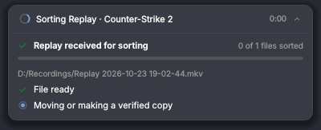
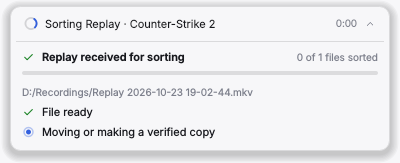
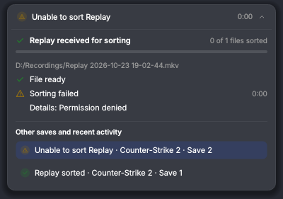
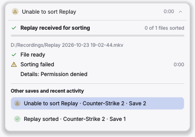

# Native Qt previews

These PNGs were captured from the actual `ActivityStatus` widget, in the dock's Native Plus style, by its optional Qt
test harness. The harness feeds explicit test lifecycle events and uses palettes in Yami and Yami Light colours, with
the pill on the dock's base colour; production activity comes from `ClipFiler`. They are not OBS screenshots or
evidence of Windows runtime validation.

| State | Dark | Light |
|---|---|---|
| Ready |  |  |
| Waiting |  |  |
| Working |  |  |
| Expanded |  |  |
| Complete |  |  |
| Failure |  |  |
| Failure details |  |  |
| Narrow |  |  |

Regeneration commands and remaining validation are in [the handover](../handover/activity-status.md).
